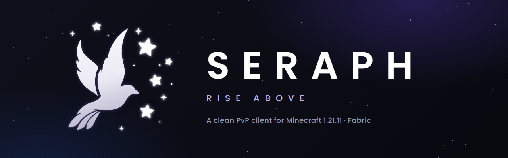
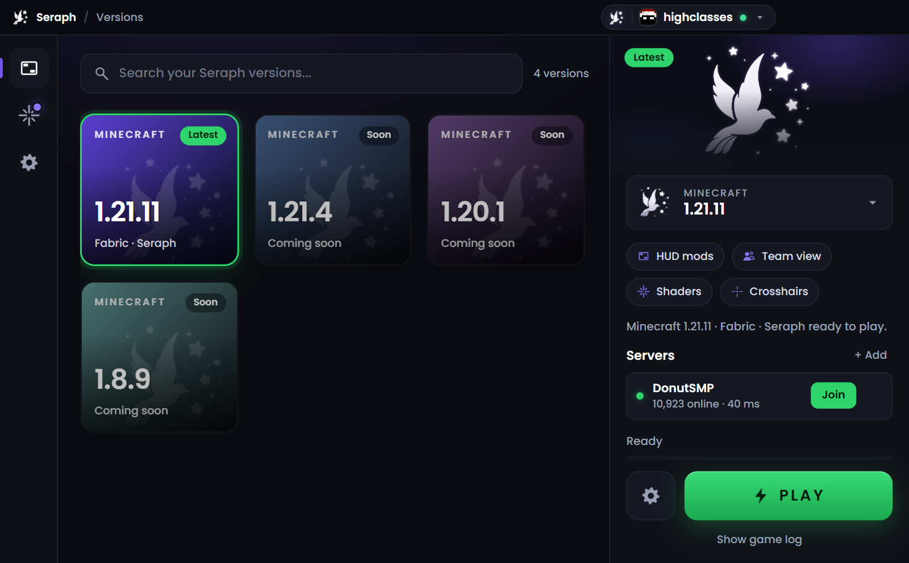
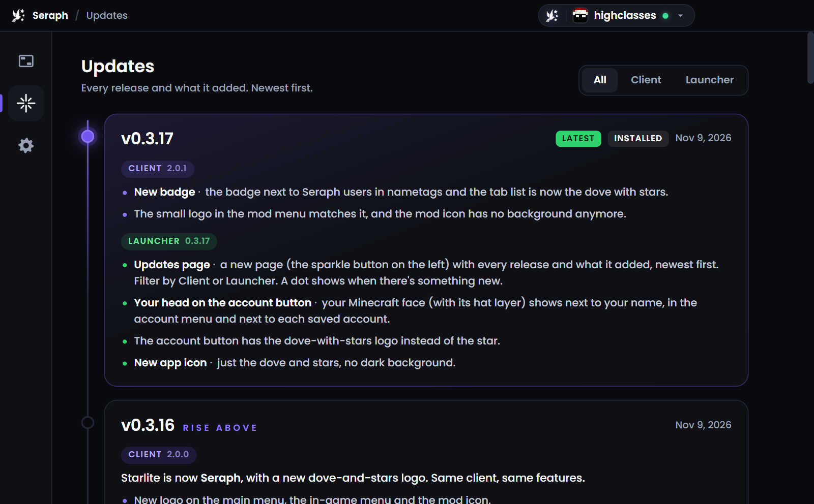
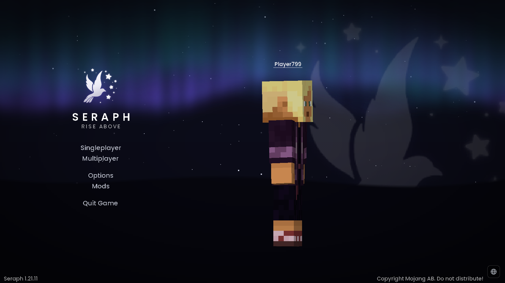
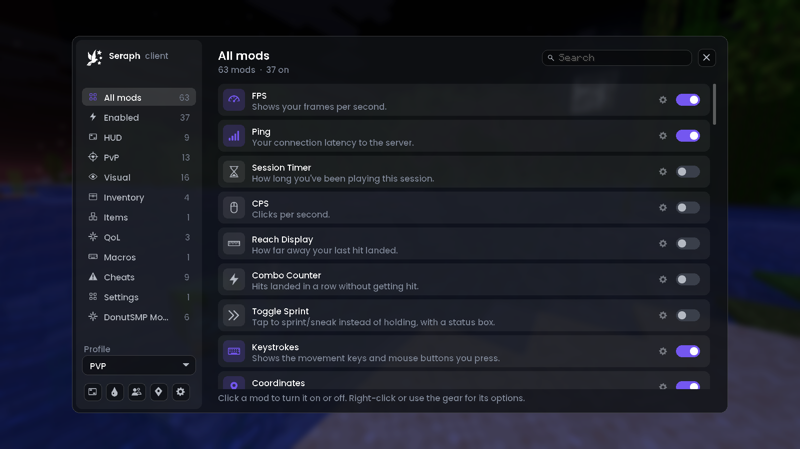
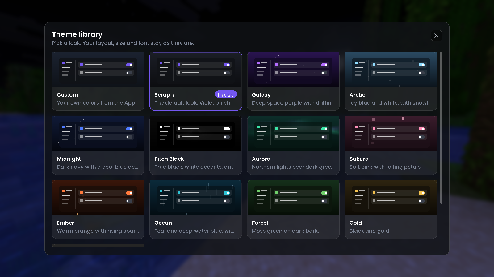

  

  
  
  
  
  
  

  <b>A clean PvP client for Minecraft Java Edition, with its own launcher.</b> 
  60+ mods in one menu, a HUD you can drag anywhere, team view, 12 themes, and Sodium + Iris built in.

  <a href="../../releases/latest"><b>⬇️ Download the latest version</b></a>

---

## 🚀 Install in a minute

1. Download the launcher for your computer from the [latest release](../../releases/latest).
2. On Windows, run **`Seraph-Client-Setup-x.y.z.exe`**. Windows may show a blue *"Windows protected your PC"* screen
   because the installer isn't code-signed: choose **More info**, then **Run anyway**.
3. On macOS 13 or later, open **`Seraph-Client-macOS-x.y.z-universal.dmg`** and drag Seraph to Applications. The app is
   unsigned; Control-click Seraph in Applications, choose **Open**, and confirm on first launch. Download a new DMG
   manually when an update is released.
4. Open **Seraph**, sign in with Microsoft (you get a short code to enter at microsoft.com/link) and press **Play**.

The first launch downloads Minecraft, Java, Fabric, Sodium and Iris for you (about 700 MB). After that the launcher and
the client keep themselves up to date.

> **You need:** Windows 10 or 11, or macOS 13 or later; a Minecraft Java Edition account; and an internet connection.
> Built for **Minecraft 1.21.11**.

---

## 🖥️ The launcher

  
  

| Feature | What it does |
|---|---|
| 🔐 **Microsoft sign-in** | Sign in once with a short code on Microsoft's own page. Your login is stored encrypted on your PC. Add more accounts and switch from the top-right menu. |
| ▶️ **One-click Play** | Installs Minecraft, Fabric, Java and your mods, then starts the game. Pick Windowed, Fullscreen or Borderless. |
| 🧩 **Mods page** | Switch mods on and off, search Modrinth and install more (checksums checked), and update them with one click. |
| 🌐 **Server list** | Save your servers and see if they're online, the player count and your ping. **Join** goes straight in. |
| ✨ **Updates page** | Every release and what it added. The launcher updates itself and tells you when there's something new. |
| 🩺 **Crash helper** | If the game crashes it tells you why in plain words, names the mod that caused it and can switch it off. |
| 🛠️ **Repair game files** | Downloads and checks everything again. Your worlds and settings are kept. |
| 💬 **Discord status** | Shows "Sitting in Launcher" on your Discord profile, then what you're playing once the game starts. |

---

## 🎮 The client

  

Press **Right Shift** in game to open the mod menu. Every mod has its own options behind the gear icon, and you can
save different setups as **profiles**.

  
  

### 📊 HUD
Drag every element wherever you want it, resize it and restyle it.

**FPS** · **Ping** · **Coordinates** (with direction and biome) · **Compass** · **Potion Effects** · **Session Timer** ·
**Scoreboard** (move, resize, hide the red numbers) · **Boss Bar** (move, resize, hide) · **Status Bars** (saturation, heart and armor colors)

### ⚔️ PvP
| Feature | What it does |
|---|---|
| **Keystrokes** and **CPS** | The keys and mouse buttons you press, and your clicks per second. |
| **Target HUD** | Health, items, armor and totem pops of the player or mob you're looking at. |
| **Armor Status** | Your armor and weapon with durability left. |
| **Combo Counter** and **Reach Display** | Hits in a row, and how far your last hit landed. |
| **Cooldowns** | Ender pearl, wind charge, shield and other item cooldowns. |
| **Item Counter** | Your pearls, gapples, totems and health pots at a glance. |
| **Toggle Sprint** | Tap to sprint or sneak instead of holding. |
| **Armor Break Alert** | Tells you when the player you're fighting breaks an armor piece or one gets low. |
| **Totem Pop Notifier** | Tells you when someone pops a totem, with their pop count. |
| **Low Durability Warning** | A sound and flash before your armor or weapon breaks. |
| **Team View** | Share position, health and gear with your team, and ping spots for them. |

### 🎨 Visual
**Zoom** (hold C) · **Freelook** (hold Left Alt) · **Crosshair** (15 styles) · **Block Outline** · **Hit Color** ·
**Hit Effects** · **Kill Effects** (lightning, fireworks and more) · **Item Physics** · **Low Fire** · **Fullbright** ·
**Fog & Visibility** (blue powder snow, so traps are easy to spot) · **Sky & Weather** · **Particle Tweaks** ·
**Title Tweaks** · **F5 Tweaks** · **Item Size** · **X-Ray** (pick the blocks you want to see)

### 🎒 Inventory
| Feature | What it does |
|---|---|
| **Chest search** | A search box greys out everything that doesn't match, even what's inside shulker boxes. |
| **Sort** | Merges stacks and sorts by name, amount, item type or rarity. |
| **Inventory Tweaks** | Walk around with inventories open, and Shift-drag to move every item you pass. |
| **Shulker Preview** | Shift-hover a shulker box to see what's inside. |
| **Dark Inventory** and **Inventory Style** | Dark, see-through and restyled inventory screens. |

### 🧭 Quality of life
**Waypoints** (B to add, M for the list) · **Alerts** (low health, someone says your name, where you died) ·
**Chat Tweaks** (timestamps, stacked repeats, longer history) · **Macros** (accept teleport requests from your team) ·
**Texture Library** (pick any item's texture from popular Modrinth packs, one item at a time) · **Discord Rich Presence**

### 🍩 DonutSMP tools
**AH Price Check** · **Selling Price Helper** · **Deal Finder** · **Inventory & Shulker Value** · **Sales Tracker** ·
**Auto Auction** (DonutSMP doesn't allow macros, so use it at your own risk)

### 🧪 Singleplayer tools
For practice worlds and testing, not for servers. They're **off by default** and **work in singleplayer only** unless
you change that yourself. Most servers don't allow them, so only use them where they're allowed.

**Pearl Trajectories** (where your pearl will land) · **Player ESP** · **Tracers** · **Auto Armor** · **Auto Tool** ·
**Auto Totem** · **Always Crit** · **No Fall** · **Freecam**

### 🖌️ Make it yours
- **12 themes** (Seraph, Galaxy, Arctic, Midnight, Pitch Black, Aurora, Sakura, Ember, Ocean, Forest, Gold and more), or
  pick your own colors.
- **Profiles** to switch between setups, for example one for PvP and one for building.
- A new **main menu** with your skin, and the Seraph badge next to other Seraph players in tab and above their names.

---

## ❓ Trouble?

- **Downloads fail or time out:** press **Play** again; Seraph retries interrupted game-file downloads and checks saved
  files. If it still fails, turn off any VPN, allow Seraph through your firewall or antivirus, or try another network.
  Press **Show game log** in the launcher and send the log to whoever helps you.
- **Asked to sign in again:** that's normal if your saved login can't be read. Just sign in again.
- **The game crashed:** the launcher tells you why and which mod caused it. Press **Copy log** to share the details.

---

  

Not an official Minecraft product. Not approved by or associated with Mojang or Microsoft. Your Microsoft login is
stored encrypted on your own PC and is only sent to Microsoft and Mojang.
